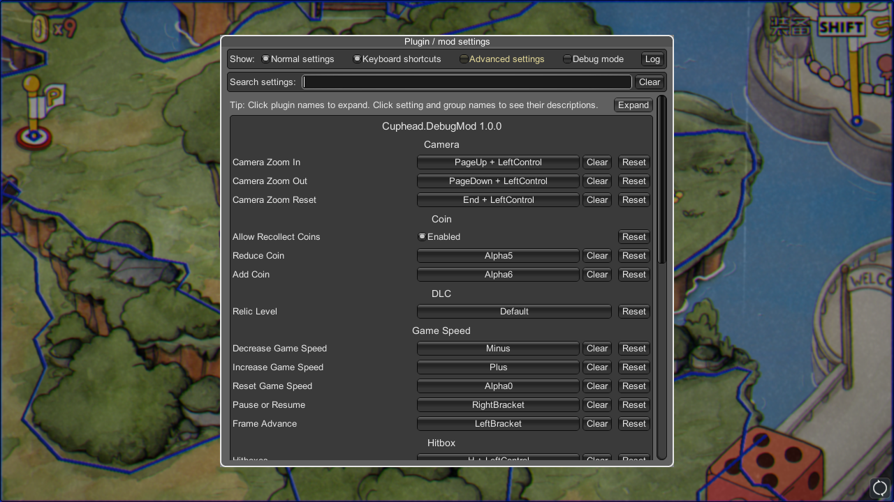
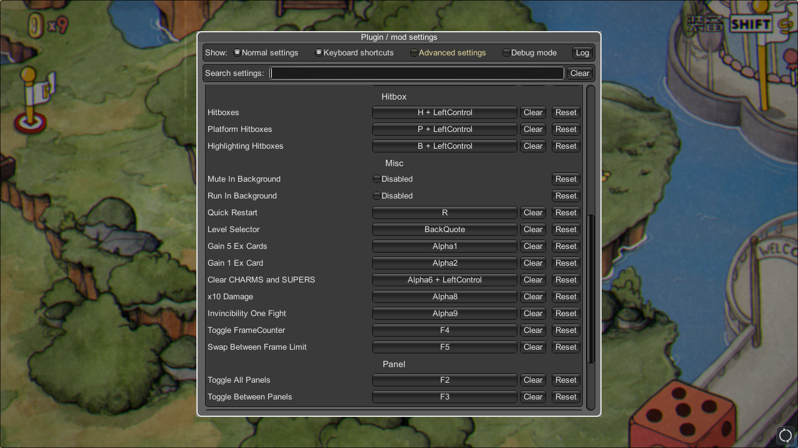

# Cuphead.DebugMod

Cuphead.DebugMod is a [BepInEx](https://github.com/BepInEx/BepInEx) plugin for practicing [Cuphead](https://store.steampowered.com/app/268910/Cuphead/), ported from the [Cuphead Speedruning discord](https://discord.gg/2BcMwEd)'s DebugMod and fixed some minor bugs, thanks to the original authors.

The original DebugMod is implemented by modifying Assembly-CSharp.dll,
which does not work with different versions and is not easy to maintain.
Porting to BepInEx avoids modifying the game files,
and benefits from the built-in config manager it is easy to change hotkeys and settings via the GUI

## Features
* Level Selector
* Quick Retry
* Info HUD
* Show Hitboxes
* Mute in Background
* Run in Background
* Tweak Game Speed
* Camera Zoom in/out
* etc...

## RNG menu (The Devil, Ribby & Croaks, Goopy Le Grande, The Root Pack, Hilda Berg, Forest Follies, Cagney Carnation, Baroness Von Bon Bon, Funfair Fever, Wally Warbles, Djimmi The Great, Beppi The Clown, Grim Matchstick, Rumor Honeybottoms, Dr. Kahl's Robot, Sally Stage Play, Werner Werman)
Press `F7` to open the in-game RNG menu built on uGUI.

* Each migrated stage gets its own page, selectable from the left-hand bar under **RNG** (currently **The Devil**, **Ribby & Croaks**, **Goopy Le Grande**, **The Root Pack**, **Hilda Berg**, **Forest Follies**, **Cagney Carnation**, **Baroness Von Bon Bon**, **Funfair Fever**, **Wally Warbles**, **Djimmi The Great**, **Beppi The Clown**, **Grim Matchstick**, **Rumor Honeybottoms**, **Dr. Kahl's Robot**, **Sally Stage Play** and **Werner Werman**); the Global section below it holds settings that apply everywhere.
* Pattern spots are shown as expandable cards: **random by default, or one forced value** — the UI only offers values the vanilla game can roll, so configured fights stay 100% faithful to what can happen unmodified.
* **Randomness kinds, told apart by a colored badge** in each card's top right corner (hover it for a tooltip): skip-to-start badges mark lists whose *start position* is rolled once (forcing one value picks where the fixed cycle begins), refresh-arrow badges mark *cycle starts re-rolled on every round* of the attack (each round plays the cycle from the new position), die badges mark spots the game *re-rolls independently on every attack*, gem badges mark one-off decisions, the stacked-list badge marks compound spots where the game picks **one attack order per fight and then walks it** — the pitchfork card pins that order and, once one is selected, which attack comes first inside it (switching to an order without the pinned attack resets it to random), the padlock badge marks lists the game can only start from part of (the rest is grayed out), and the die-over-list badge marks per-pass pattern picks that are paired with a once-per-fight walked index (the candy corn's turns).
* **Per-attack spots** use a dedicated editor instead of the radio list: a cycler with flanking arrows plus a separate **Random** checkbox (random is never part of the cycle), option pips under every value, and plan steps below — the `+` button appends further steps played in order on each occurrence, every step can itself be marked random again, and the **Repeat?** checkbox on the last entry makes that value repeat forever (the classic constant pin) instead of handing back to natural randomness. Ordered cyclic lists (start positions) do not get plans.
* **Numeric delays** (clap/spider/ring delays, ...) are expandable cards too: the first value and every sequence step carry the same Random checkbox, the **Repeat?** flag marks the last entry, and the spot only counts as active while at least one value in the list is not random.
* **Pattern forms** (opt-in): enable **"Pattern forms"** under Global in the menu (or the `Enable Pattern Forms` config entry) to switch to forms-only editing — every spot is then edited inside named bundles covering the whole fight (phases are subdivisions inside a form), weighed per fight and difficulty with the slider system, and can be enabled/disabled per form without deleting. Each fight draws one form (weighted) and that form is authoritative: its pins apply throughout and its unpinned spots are naturally random — simple-mode pins never leak into a drawn form's fight. With the toggle off, forms are hidden, do not apply, and every pattern spot is simply random-or-pinned.
* Options and labels are read live from the game's own `LevelProperties` data (or the scene, for Forest Follies' spawner strings), so they can never drift from the version you are playing.
* Profiles: **Vanilla**, **Perfect RNG (1.1+ Any%)** and an editable **Custom** profile, stored in `BepInEx/config/Cuphead.DebugMod/rng_profiles.cfg` (a missing line always means vanilla).
* The remaining bosses are still configured through the legacy settings window (`F1`) until they migrate over.

## How to use
1. [Download](https://github.com/DemoJameson/Cuphead.DebugMod/releases) the zip then unzip all files into the game folder (the folder where Cuphead.exe/Cuphead.app is located).
2. (Windows) Run `Cuphead.exe` start the game with plugin. Run `Cuphead_Vanilla.bat` start the game without plugin.
3. (macOS) Launch `Terminal`, run `chmod +x run_bepinex.sh` (only once), then run `./run_bepinex.sh` start the game with plugin.
4. Press `F1` show settings.
5. (Windows) If the game seemingly launches without the plugin active, try downloading [this](https://github.com/DemoJameson/Cuphead.DebugMod/blob/master/Misc/steam_appid.txt) text file, place it in the same directory where Cuphead.exe is located, then try starting the game again.

## Credits
* [BepInEx](https://github.com/BepInEx/BepInEx)
* [BepInEx.ConfigurationManager](https://github.com/BepInEx/BepInEx.ConfigurationManager)
* [BepInEx.ScriptEngine](https://github.com/BepInEx/BepInEx.Debug#scriptengine)
* [BepInEx.NStrip](https://github.com/BepInEx/NStrip)
* [UnityExplorer](https://github.com/sinai-dev/UnityExplorer)
